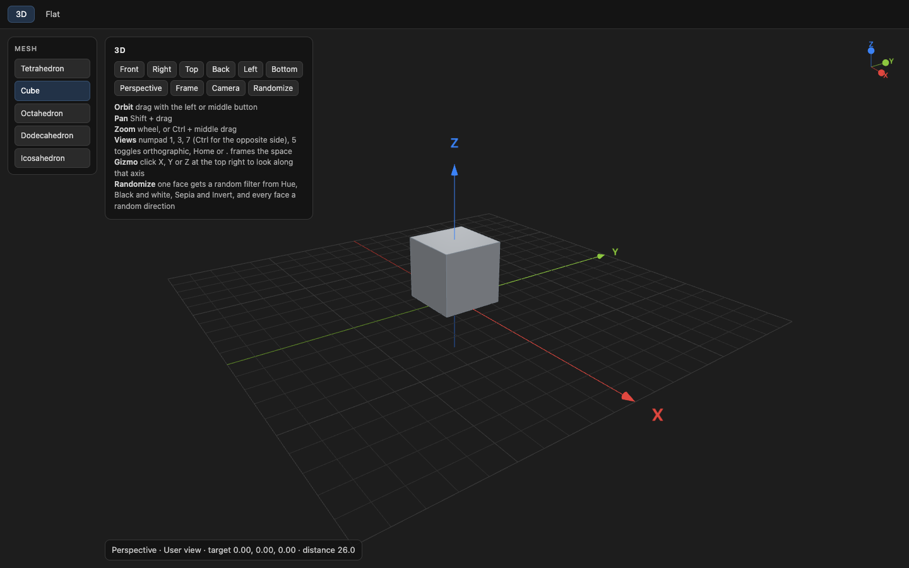
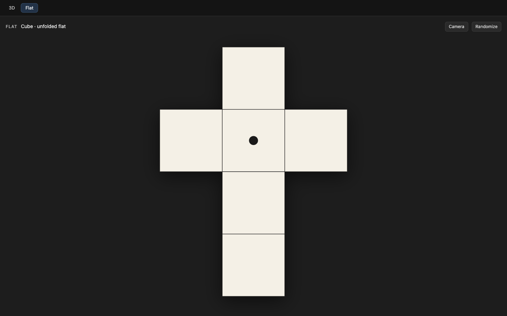

# 3D Objects Camera Projections



Geometric solids in a three.js 3D space with Blender-like navigation, and the camera projection onto their faces. Pick a solid, orbit it, then switch to Flat and see it unfolded into one sheet.



Built by **Juan Diaz** at the [ACRYL Bootcamp](https://github.com/acrylworkshop/bootcamp-2026-11-20), Vienna, 20 November 2026.

## Run it

Node.js 22.19 or newer.

```sh
npm install
npm run dev
```

`npm run dev` opens the app inside the ACRYL frame and prints its address. The 3D state is at `/space` and the Flat state at `/flat` (in the frame: `/app/space` and `/app/flat`). `npm start` runs the app on its own, without the frame.

## What is in it

- `plugins/space`: the three.js 3D space, Blender-like orbit, pan and zoom, painted X, Y and Z axes.
- `plugins/selection`: the selected solid and its camera, one selection for the whole app.
- `plugins/flat`: the selected solid unfolded into one flat sheet.
- `plugins/states`: the state menu that switches between 3D and Flat.

It is an ACRYL Blends app: [blend.yaml](blend.yaml) says which plugins it mounts, and every part is a Cordis plugin.
